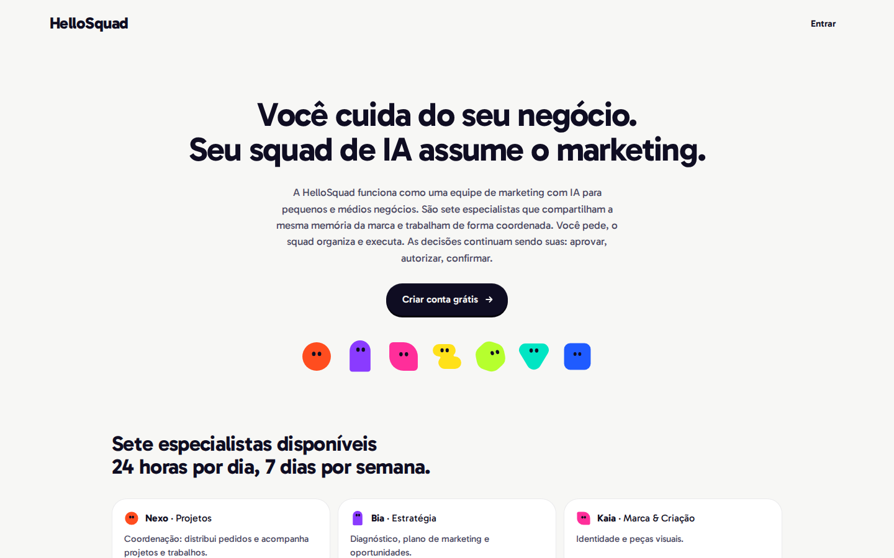
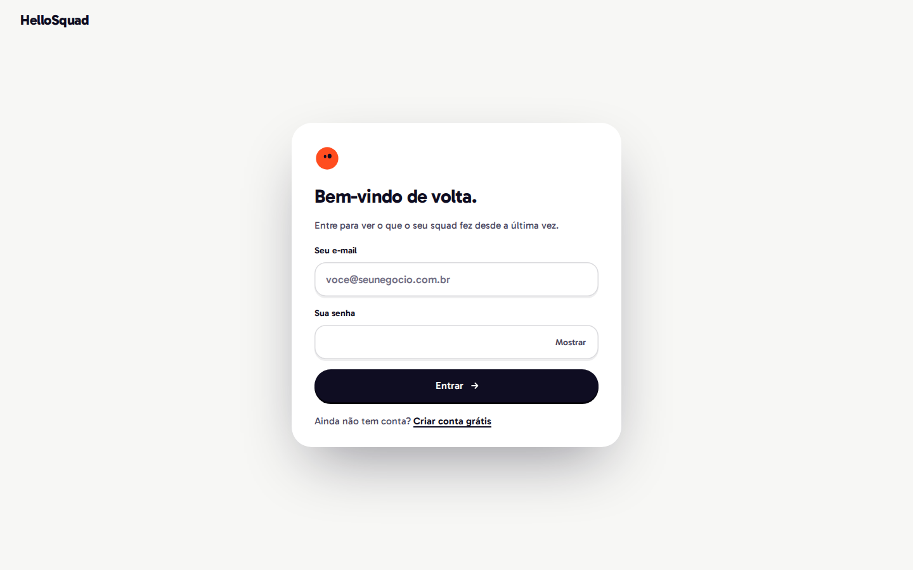
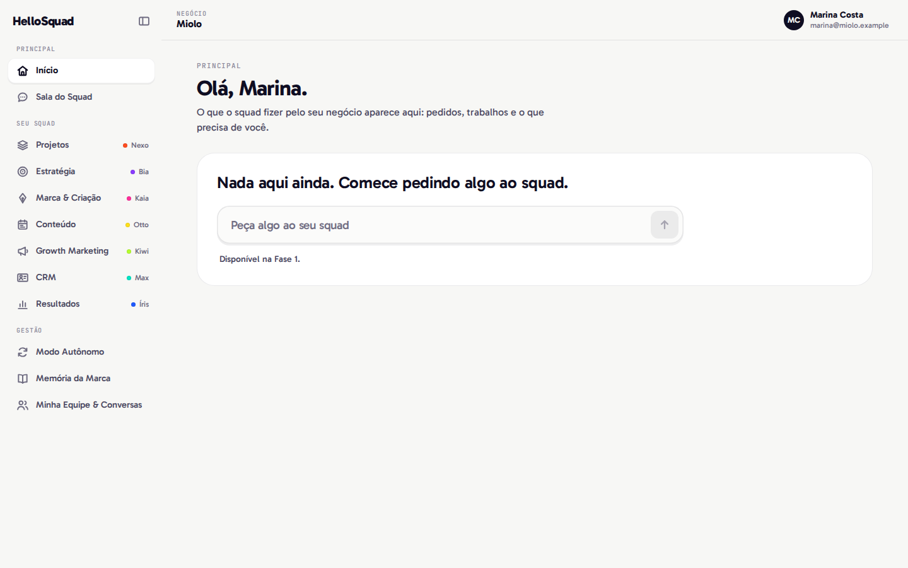
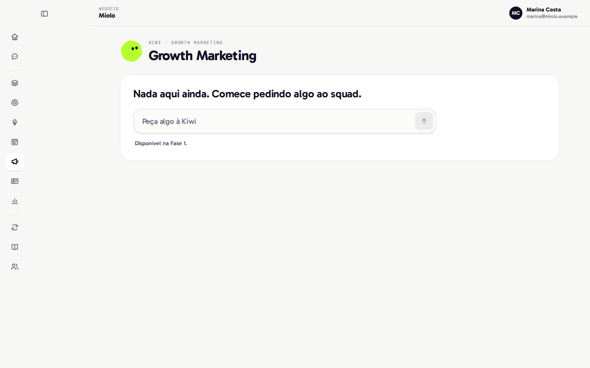
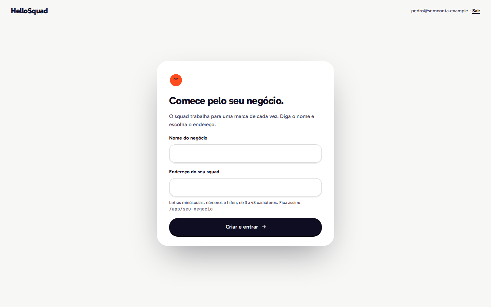
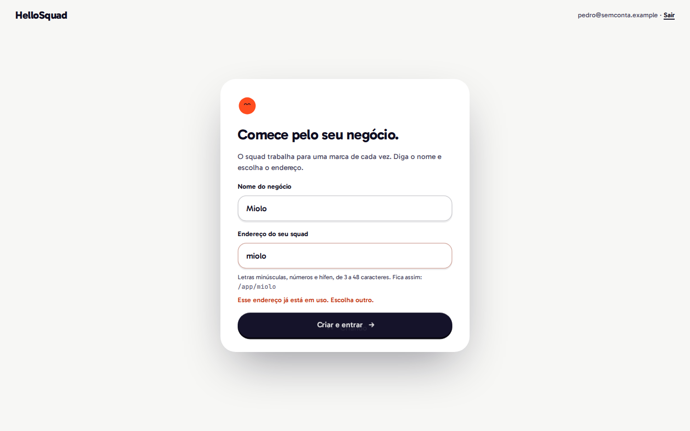
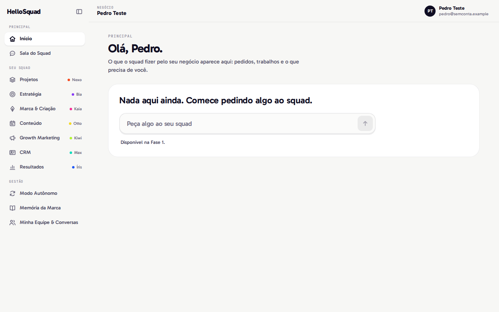

# A0 — Relatório de fechamento (Aranha)

**Fatia:** A0, Design System e casca do app. **Data:** 16/10/2026, 01:18 → 02:05. **Estado:** entregue. Critério do plano atendido: Marina entra e vê a casca com o workspace Miolo; Pedro entra, cai na criação de workspace, cria e entra no dele; lint e build verdes. Pendências e perguntas nas §5 e §6.

## 1. O que foi entregue

| # | Item | Onde | Commit |
|---|---|---|---|
| 1 | **Design System** `@hellosquad/ui`: `build-tokens.ts` gera `tokens.css` (variáveis `--hs-*`) e `tokens.ts` (tipado) de `tokens.json`; `extract-ds.ts` extrai do `bundle.js` e do `ProductUIV4.dc.html` o desenho dos 7 agentes (corpo, contorno, olhos em 6 expressões x 3 cortes ópticos), os 11 ícones, os glifos de status e os ícones da barra lateral, e lê `squad/*/agent.yaml`; fontes Gabarito e JetBrains Mono auto-hospedadas (woff2 variável, licença OFL ao lado); primitivos `Button`, `CommandField`, `StatePill`, `Agent`, `Icon` (+ `NavIcon`), `AgentDot`; README com exemplo de cada um | `packages/ui/` | `d7b278c` |
| 2 | **Cliente da API** `@hellosquad/contracts`: tipos gerados com `openapi-typescript` (`pnpm --filter contracts generate`), cliente `openapi-fetch` que injeta `Authorization: Bearer` e `unwrap()` que converte o envelope `error.code/message/details` em `ApiError` | `packages/contracts/` | `0037201` |
| 3 | **Auth no web** com `@supabase/ssr` (clientes de browser e servidor com cookies): `/entrar`, `/criar-conta` (nome em `options.data.full_name`), `/sair` (POST), middleware que protege `/app/*` e volta para a página pedida depois do login | `apps/web/lib/`, `apps/web/middleware.ts`, `apps/web/app/(auth)/`, `apps/web/app/sair/` | `b2d05dc` |
| 4 | **Casca do app**: `/app` lê `GET /me` e escolhe o destino; `/app/[workspace]` com a barra lateral da V4.6 (Principal; Seu squad com `AgentDot` e nome de cada agente; Gestão), recolhível e em gaveta no celular; cabeçalho com o negócio e o menu da pessoa; páginas com estado vazio honesto e `CommandField` indisponível ("Disponível na Fase 1."); `/app/novo-workspace` com nome + endereço, `POST /workspaces` e 409 em português; todo `/app/*` com `noindex` (metadata e `X-Robots-Tag`) | `apps/web/app/app/`, `apps/web/components/shell/` | `ffeb741` |
| 5 | **Página pública `/`**: Hero com a copy aprovada da Landing V1, wordmark em Gabarito 800 (texto vivo), CTA "Criar conta grátis"; Metadata API (title, description, canonical, `hreflang`, Open Graph, `lang="pt-BR"`); JSON-LD `Organization` + `SoftwareApplication`; `sitemap.ts`, `robots.ts` (GPTBot, ClaudeBot, PerplexityBot e Google-Extended liberados; `/app` bloqueado), `public/llms.txt` | `apps/web/app/page.tsx`, `apps/web/app/{robots,sitemap}.ts`, `apps/web/public/llms.txt` | `bd5e3fc` |
| 6 | **Testes**: Vitest + Testing Library (53 testes nos pacotes); Playwright com Chromium (5 testes, os dois fluxos pedidos e mais três); alvos `make test-web` (agora roda lint, tipos e Vitest) e `make e2e`; CI versionado roda tipos e Vitest dos pacotes | `packages/*/test/`, `apps/web/e2e/`, `Makefile`, `infra/github/workflows/ci.yml` | `5de6d8e` |
| 7 | `SETUP_LOCAL.md` (variáveis `NEXT_PUBLIC_*`, como rodar o web, rotas, e2e, problemas comuns), `.env.example`, capturas em `docs/parciais/a0/`, este relatório e o progresso | `docs/` | commit deste relatório |

## 2. Como foi verificado

Todas as rodadas abaixo são de 16/10, depois do último commit de código (`5de6d8e`).

### 2.1 `pnpm lint && pnpm typecheck && pnpm build` (02:01, exit 0)

```text
$ pnpm --filter web lint
$ eslint
$ pnpm -r --if-present typecheck
packages/contracts typecheck$ tsc --noEmit
packages/ui typecheck$ tsc --noEmit
packages/contracts typecheck: Done
packages/ui typecheck: Done
apps/web typecheck$ tsc --noEmit
apps/web typecheck: Done
$ pnpm --filter web build
$ next build
   ▲ Next.js 15.5.28
   - Environments: .env
 ✓ Compiled successfully in 2.6s
   Linting and checking validity of types ...
 ✓ Generating static pages (11/11)

Route (app)                                 Size  First Load JS
┌ ○ /                                      187 B         110 kB
├ ○ /_not-found                            133 B         102 kB
├ ƒ /app                                   175 B         110 kB
├ ƒ /app/[workspace]                       170 B         106 kB
├ ƒ /app/[workspace]/equipe                170 B         106 kB
├ ƒ /app/[workspace]/memoria-da-marca      170 B         106 kB
├ ƒ /app/[workspace]/modo-autonomo         170 B         106 kB
├ ƒ /app/[workspace]/sala-do-squad         170 B         106 kB
├ ƒ /app/[workspace]/squad/[agente]        170 B         106 kB
├ ƒ /app/novo-workspace                  2.07 kB         112 kB
├ ○ /criar-conta                         1.84 kB         111 kB
├ ƒ /entrar                              1.78 kB         111 kB
├ ○ /robots.txt                            133 B         102 kB
├ ○ /sair                                  175 B         110 kB
└ ○ /sitemap.xml                           133 B         102 kB
+ First Load JS shared by all             102 kB
ƒ Middleware                             94.8 kB
```

A `/` sai estática (boa para Core Web Vitals); a área logada é dinâmica. No CSS do build: `@font-face` das duas fontes apontando para `/_next/static/media/*.woff2` e **0** referências a `fonts.googleapis`/`fonts.gstatic` em `.next/`.

### 2.2 `make test` (02:02, exit 0)

```text
cd apps/backend && uv run ruff check . && uv run ruff format --check . && uv run pytest
All checks passed!
23 files already formatted
collected 45 items
tests/test_auth.py ....................                                  [ 44%]
tests/test_health.py ..                                                  [ 48%]
tests/test_identity_api.py ......................                        [ 97%]
tests/test_openapi.py .                                                  [100%]
============================== 45 passed in 0.92s ==============================
pnpm --filter web lint
$ eslint
pnpm -r --if-present typecheck
packages/contracts typecheck: Done
packages/ui typecheck: Done
apps/web typecheck: Done
pnpm -r --if-present test
packages/contracts test:  Test Files  1 passed (1)
packages/contracts test:       Tests  9 passed (9)
packages/ui test:  Test Files  5 passed (5)
packages/ui test:       Tests  44 passed (44)
pnpm exec supabase test db
…/00_extensions.test.sql ............. ok
…/01_rls_coverage.test.sql ........... ok
…/02_workspace_isolation.test.sql .... ok
…/03_membership_management.test.sql .. ok
…/04_invitations.test.sql ............ ok
…/05_audit_events.test.sql ........... ok
…/06_create_workspace.test.sql ....... ok
All tests successful.
Files=7, Tests=98
Result: PASS
```

### 2.3 Testes de componente e de contrato (Vitest)

| Arquivo | O que prova |
|---|---|
| `packages/ui/test/tokens.test.ts` (5) | `tokens.css` e `tokens.ts` iguais ao que o gerador produz de `tokens.json`; toda cor vira `--hs-*` com o mesmo valor; apelido `{hs-coord}` resolvido. |
| `packages/ui/test/generated.test.ts` (9) | `agents.ts`, `icons.ts` e `product-ui.ts` em dia com `bundle.js`, `.dc.html` e `squad/`; ordem oficial dos 7; cor de cada agente em `squad/` igual à do desenho do DS; Kiwi = Growth Marketing, "a Kiwi"; 6 expressões x 3 cortes; 11 ícones; 7 glifos de status. |
| `packages/ui/test/Agent.test.tsx` (8) | **Renderiza os 7 agentes** com a cor oficial e nome acessível (Nexo … Íris); decorativo sem título; `mini` 16 / `padrao` 24 e corte óptico maior em 96 px; expressão e `thinking`; Kiwi girado como no DS; `AgentDot`. |
| `packages/ui/test/Button.test.tsx` (8) | Primário com lábio e seta; `loading` com `aria-busy` e sem clique duplo; `done`; indisponível; secundário com play, pílula, fantasma; `type="submit"`; link com componente próprio; sem handler em Server Component. |
| `packages/ui/test/StatePill.test.tsx` (14) | Cada um dos 7 estados com texto e glifo próprios (os 7 desenhos são diferentes); rótulos em português; rótulo próprio; presença (agente + ação + detalhe); `CommandField` (Enter envia, Esc limpa, vazio não envia, indisponível com nota ligada por `aria-describedby`). |
| `packages/contracts/test/client.test.ts` (9) | `schema.ts` em dia com `openapi.json`; Bearer injetado (string e função), sem cabeçalho sem token; corpo do POST; **wrapper de erro**: 409 `slug_taken`, 422 com detalhes por campo, 401 `invalid_token`, 502 em HTML → `unexpected_response`, API fora do ar → `network_error` (status 0). |

Os testes de defasagem pegam regressão (mutação, 16/10): `--hs-papel` trocado para `#F7F7F6` no `tokens.css` → 2 falhas; um traço do ícone `arrow` alterado em `icons.ts` → 1 falha; um campo a mais em `Me` no `schema.ts` → 1 falha. Arquivos restaurados e testes de novo verdes.

### 2.4 Playwright (`make e2e`, 02:02, exit 0)

O alvo faz o build, o Playwright reaproveita a API no ar (ou sobe `make dev-api`) e sobe `next start` na 3100. Chromium instalado sem problema de rede (`chromium-headless-shell v1248`, 120 MB em `~/.cache/ms-playwright`).

```text
Running 5 tests using 1 worker
  ✓  1 [chromium] › e2e/auth-shell.spec.ts:5:7 › área logada › sem sessão, /app manda para o login e volta para onde a pessoa ia (444ms)
  ✓  2 [chromium] › e2e/auth-shell.spec.ts:14:7 › área logada › senha errada mostra o erro em português e mantém o e-mail (281ms)
  ✓  3 [chromium] › e2e/auth-shell.spec.ts:23:7 › área logada › Marina entra e vê a barra lateral com o workspace Miolo (717ms)
  ✓  4 [chromium] › e2e/auth-shell.spec.ts:73:7 › área logada › Pedro entra sem workspace, cria pedro-teste-<timestamp> e cai no shell dele (890ms)
  ✓  5 [chromium] › e2e/auth-shell.spec.ts:101:7 › site público › página inicial em pt-BR com SEO e crawlers de IA liberados (169ms)
cd apps/backend && uv run hellosquad-local-db seed ../../supabase/seed.sql
  -        sem membership  pedro@semconta.example
seed aplicado: ../../supabase/seed.sql
  5 passed (3.8s)
```

O teste 3 confere: "Miolo" no cabeçalho, "Olá, Marina.", os grupos Principal / Seu squad / Gestão, os 7 itens do squad pelo nome acessível ("Growth Marketing, com a Kiwi"…), os 5 demais, `aria-current` no Início, o estado vazio e o campo indisponível, navegação para a Kiwi, recolher a barra, `noindex` e Sair pelo menu. O teste 4: Pedro em `/app/novo-workspace`, "miolo" → "Esse endereço já está em uso. Escolha outro." com `aria-invalid`, depois `pedro-teste-<timestamp>` → `/app/pedro-teste-…` com "Pedro Teste" no cabeçalho. O teardown roda `make seed`; logo depois, `make test-db` deu `Result: PASS` (Pedro voltou a "sem membership").

### 2.5 Sondas à mão (Playwright em script, contra o web local)

- **Cadastro**: campos vazios → "Digite o seu nome." / "Digite um e-mail válido." / "A senha precisa de pelo menos 6 caracteres."; conta nova `a0-cadastro-<ts>@teste.example` → `/app/novo-workspace`; `GET /me` com o JWT dela devolveu `full_name: "Cadastro Teste A0"`; mesmo e-mail de novo → "Já existe uma conta com esse e-mail. Entre com ela.". O usuário de teste foi apagado do banco local (`DELETE 1`; `auth.users` voltou a 5).
- **Teclado**: `/entrar` → pular para o conteúdo, marca, e-mail, senha, Mostrar, Entrar, Criar conta grátis. Casca → pular, marca, recolher, Início, Sala do Squad, Projetos… Menu da pessoa abre com Enter no primeiro item, seta para baixo anda, Esc fecha e devolve o foco ao botão.
- **Celular (390 x 844)**: a barra vira gaveta; abre com foco no Início, Esc fecha e devolve o foco a "Abrir o menu", navegar fecha; `/` sem rolagem horizontal em 1440 e 390.
- **Contraste (WCAG, calculado)**: Tinta/Papel 17,78:1; Tinta suave/Papel 8,29:1; hs-kbd/Papel 4,80:1; placeholder hs-ph/Branco 4,86:1; erro #C2360F sobre coral 10% 4,84:1; status Concluído 9,39:1. Abaixo de AA: **hs-rotulo #8A8799/Papel 3,26:1** (rótulos mono de grupo, valor oficial do DS, ver pergunta 3) e o primário indisponível 2,58:1 (controle desabilitado, isento).

### 2.6 Capturas (`docs/parciais/a0/`, geradas pelo Playwright com `E2E_SCREENSHOTS`)

| Tela | Arquivo |
|---|---|
| Página pública |  |
| Login |  |
| Casca da Marina (Miolo) |  |
| Barra recolhida (ambiente da Kiwi) |  |
| Pedro sem workspace |  |
| Pedro, endereço em uso (409) |  |
| Casca do Pedro |  |

### 2.7 Segredo, dados fictícios, containers

- `git grep` nos arquivos versionados pelos valores de `SUPABASE_PUBLISHABLE_KEY`, `SUPABASE_SECRET_KEY`, `NEXT_PUBLIC_SUPABASE_PUBLISHABLE_KEY` e pela senha do `hellosquad_api`: 0 arquivo em cada; JWT `eyJ…`: 0; `sb_secret_`/`sb_publishable_` com valor: 0; `sk-ant-`: só o texto do relatório da S0. Logs da A0 em `/tmp`: 0 chave. `.env` segue ignorado (`.gitignore:2`).
- O web recusa subir se `NEXT_PUBLIC_SUPABASE_PUBLISHABLE_KEY` receber uma chave `sb_secret_`.
- Dados: só os usuários do seed (`.example`) e um usuário de teste `@teste.example`, apagado. Nenhum dado real.
- `git diff 0d75725 HEAD -- apps/backend supabase`: vazio. Nada alterado na API nem no Supabase.
- `docker ps`: 46 containers, 11 `*_hellosquad`, a mesma contagem do início. Mexi só no banco do HelloSquad (um `DELETE` do usuário de teste) e não reiniciei container.

## 3. Decisões tomadas

1. **Tokens.** As cores mantêm o nome do JSON (`--hs-papel`, `--hs-coord`); as escalas ganham o prefixo (`--hs-s-4`, `--hs-r-pilula`, `--hs-e1-tecla`, `--hs-t-toque`, `--hs-e-saida`); os estilos de texto viram `--hs-type-<nome>-size|weight|tracking|leading`; o apelido `{hs-coord}` vira `var(--hs-coord)` no CSS e valor resolvido no TS. O Tailwind do web tem a paleta padrão desligada (`--color-*: initial`): só as cores do DS existem como utilitária.
2. **Fontes.** Woff2 variáveis do Google Fonts via fontsource (Gabarito 400–900, JetBrains Mono 100–800), só o subconjunto latino (cobre o português). `next/font/local` aponta para `packages/ui/src/fonts/`; a família vem de `tokens.json` e o arquivo, do `next/font` (`--hs-font-display`/`--hs-font-mono`). Gabarito com preload; JetBrains Mono sem (é só rótulo).
3. **Identidade extraída, não desenhada.** Agentes, olhos e ícones vêm do objeto `D` do `bundle.js`; glifos de status (`WK_SG`, `RIC5`) e ícones da barra (`IC.nav`, `IC.panel`), do `ProductUIV4.dc.html`. O SVG entra como no DS (`dangerouslySetInnerHTML` de string estática gerada do bundle; nunca entrada de usuário).
4. **Button.** Variantes com os nomes do DS: `primary` (Tinta com lábio), `secondary` (play), `soft` (a pílula branca) e `ghost`; todas têm raio de pílula. O "pílula" do briefing é a `soft`. Só anexa `onClick` quando há handler ou estado ocupado, para funcionar em Server Component.
5. **StatePill** tem dois usos: `state` (os 7 estados da V4.6, "um desenho por estado": Aguardando você, Em andamento, Programado, Concluído, Pausado, Bloqueado, Erro) e presença (`agent` + ação + detalhe, o StatePill do bundle). Chaves em inglês, rótulos em português.
6. **Cliente da API.** `openapi-fetch` + `unwrap()`, que preserva a inferência dos tipos por rota. Erros do próprio cliente: `network_error` e `unexpected_response`.
7. **Auth por Server Actions** (login, cadastro, saída). Sair é sempre POST: `/sair` mostra um botão, e o menu usa o mesmo action; um prefetch nunca encerra a sessão. Sai só deste navegador (`scope: "local"`).
8. **Middleware** só em `/app`, `/entrar`, `/criar-conta` e `/sair` (a página pública fica estática). Usa `getClaims()` (confere o JWT pelo JWKS e renova a sessão). `?next=` só aceita caminho `/app…` (sem redirecionamento aberto).
9. **Host do redirecionamento.** Visto com `curl`: o redirecionamento de `127.0.0.1:3100/app/miolo` saía para `http://localhost:3100/entrar…`, porque o `NextURL` do Next troca `127.0.0.1` por `localhost`. Como os cookies da sessão são por host, quem usa `127.0.0.1` perderia a sessão no meio do fluxo. O middleware monta o `Location` pelo `Host` e o `next.config.ts` liga `skipMiddlewareUrlNormalize`; depois disso o `Location` ficou relativo (`/entrar?next=…`).
10. **`.env` da raiz no web.** O `next.config.ts` carrega o `.env` da raiz com `@next/env` (`forceReload`, porque o Next guarda em cache o env de `apps/web`). Não há `.env` em `apps/web`.
11. **A API é chamada só pelo servidor do Next** (Server Components e Server Actions) com o token da sessão, por `API_URL`. O browser não fala com a API; o CORS da S0 fica para quando precisar.
12. **Casca.** Barra de 256 px, 72 px recolhida, estado lembrado por cookie (`hs_sb`) para o servidor já desenhar certo; abaixo de 1024 px vira gaveta (Esc, foco, `inert` no resto). Rotas: `/app/<slug>`, `/sala-do-squad`, `/squad/<agente>` (id de `squad/`), `/modo-autonomo`, `/memoria-da-marca`, `/equipe`. Slug de outro tenant dá 404 (o web só mostra o que o `/me` devolveu, e a API já filtra pela RLS).
13. **Copy.** Login e cadastro com a copy aprovada dos modais da Landing V1 ("Bem-vindo de volta.", "Crie sua conta grátis.", "Seu e-mail", "Entrando", "Criando sua conta"). Workspace aparece como **negócio**, vocabulário da V4.6 ("Adicionar um negócio"). Estado vazio com o texto do briefing.
14. **Novo workspace.** O endereço é sugerido a partir do nome (sem acento) até a pessoa editar; mesmas regras da API no cliente e no Server Action; `novo-workspace` é recusado (a rota sombrearia o workspace).
15. **Página pública.** Definição e responsabilidades vêm do handoff (README, seção A), com a Kiwi em Growth Marketing. Sem imagem de Open Graph (não há logotipo oficial; o wordmark é provisório) e sem `offers` no JSON-LD (preço é decisão comercial pendente). Saiu o `favicon.ico` padrão do create-next-app, que era um logotipo de terceiro.
16. **Dependências.** O pnpm 12 recusa versão com menos de 1 dia. Fixei versões anteriores (vitest 5.0.4, jsdom 30.1.2, supabase-js 2.117.3) em vez de aceitar as exceções que o `pnpm add` escreveu sozinho no `pnpm-workspace.yaml`.
17. **Skills.** `frontend-vix` (principal), `ui-ux-pro-max` (apoio, checklist de acessibilidade, toque e formulários) e `verification-before-completion`. Não abri `web-design-guidelines` por causa do limite de duas; a checagem de acessibilidade foi à mão (§2.5).

## 4. Onde divergi do briefing ou do handoff (tudo reversível)

1. **Nome do agente na barra lateral** em hs-kbd `#6E6B80` (4,80:1). A V4.6 usa `#A6A4B0` (2,29:1, abaixo de AA). Uma linha no `shell.css`.
2. **Barra lateral, item do squad:** `AgentDot` + nome, como pede o briefing. A V4.6 mostra o agente mini no hover e no item ativo.
3. **Menu da pessoa no cabeçalho**, como pede o briefing. A V4.6 põe a conta no pé da barra.
4. **Modo Autônomo** com o ícone `auto` da própria V4.6, não o mini interruptor animado do item (que depende do estado das rotinas, inexistente na Fase 0).
5. **CommandField** com largura fluida (o DS fixa 740 px) e estado indisponível, que o DS não desenha. Secundário, pílula e fantasma ganharam estilo de indisponível (o DS só desenha o primário).
6. **Gaveta no celular:** a V4.6 só existe em 1440 e 1280; o desenho mobile é proposta minha.
7. **Rótulo do botão ocupado:** o rótulo de repouso fica `aria-hidden` enquanto o botão carrega (no bundle, o leitor de tela ouvia os dois).

## 5. Pendências

1. **Assets oficiais:** favicon, imagem de Open Graph e o SVG do wordmark (o handoff diz que o wordmark em texto é provisório e não deve ser recriado).
2. **Domínio de produção** para `NEXT_PUBLIC_SITE_URL` (canonical, sitemap, robots, JSON-LD). Hoje: `http://127.0.0.1:3100`.
3. **API: slugs reservados.** O web recusa `novo-workspace`, mas a API aceita. Sugestão para a fatia de backend: lista de reservados (`novo-workspace` e o que vier de rota fixa em `/app`).
4. **CI:** continua em `infra/github/workflows/` até alguém com escopo `workflow` mover (herdado da J0). Agora roda tipos e Vitest dos pacotes; o Playwright precisa do Supabase local, então fica no `make e2e`.
5. **Cliente de browser** (`apps/web/lib/supabase/client.ts`) pronto e sem uso: entra com Realtime na Fase 1.
6. **Segurança para avaliar (H0/Fase 5):** sem Content-Security-Policy ainda; o cookie de sessão do `@supabase/ssr` é legível por JS (padrão da biblioteca), então um XSS exporia o token.
7. **Fontes:** só o subconjunto latino. Nome com caractere fora dele (por exemplo "ł") cai na fonte do sistema.
8. `tsc` do web inclui `.next/types/**`: uma vez, com o `next dev` aberto, ele acusou rota velha em `.next/types/validator.ts`; sumiu quando o dev recompilou. Se aparecer, `rm -rf apps/web/.next`.

## 6. Perguntas para o dono (não decidi)

1. Na interface, workspace aparece como **negócio** ("Comece pelo seu negócio.", "Adicionar um negócio", "Endereço do seu squad"). Aprova?
2. "**Disponível na Fase 1.**" é o texto do briefing, mas "Fase 1" é jargão interno para o dono do negócio. Mantém ou troca (por exemplo "O squad começa a responder por aqui em breve.")?
3. **hs-rotulo** `#8A8799` sobre Papel dá 3,26:1, abaixo de AA para texto pequeno, e é o token oficial dos rótulos mono (grupos da barra, "NEGÓCIO"). Mantém o DS ou escurece para hs-kbd (4,80:1)? Não mudei token oficial sem o seu aval.
4. Nome do agente na barra: fica hs-kbd (minha troca, §4.1) ou volta ao `#A6A4B0` da V4.6?
5. O placeholder aprovado do e-mail é `voce@seunegocio.com.br`. As diretrizes pedem `.example` para dado fictício; é texto de interface, não dado de teste, então mantive. Confirma?
6. "Bem-vindo de volta." é a copy aprovada, no masculino. Quer uma versão neutra?
7. O CTA "Criar conta grátis" afirma que existe conta gratuita, e preço ainda é decisão pendente. Mantém o "grátis"? (Por isso o JSON-LD está sem `offers`.)
8. Cadastro com e-mail já usado responde "Já existe uma conta com esse e-mail." e revela que a conta existe. Na nuvem, com confirmação de e-mail ligada, a Auth esconde isso. Aceitável no local?

## 7. Para a H0 (Hulk)

Alvos sugeridos: `?next=` com `//site`, `https://…`, `/apple` e `\` (só `/app…` passa); `/app/<slug de outro tenant>` (404 no web, 404 na API); `/sair` por GET não pode encerrar sessão; Server Action de criar workspace chamada com sessão vencida; `NEXT_PUBLIC_SUPABASE_PUBLISHABLE_KEY` com `sb_secret_` (o web deve recusar); `X-Robots-Tag` e `meta robots` em todo `/app/*`; troca de host 127.0.0.1/localhost no meio do fluxo. Testes existentes: `apps/web/e2e/auth-shell.spec.ts`, `packages/*/test/`.

## 8. Estado em que deixei a máquina

- Supabase do HelloSquad no ar (11 containers), banco no estado do seed (Pedro sem membership; usuário de teste do cadastro apagado).
- API e web parados (8100 e 3100 livres).
- `.env` local ganhou 4 linhas no formato do `.env.example`: `NEXT_PUBLIC_SUPABASE_URL`, `NEXT_PUBLIC_SUPABASE_PUBLISHABLE_KEY` (copiada de `SUPABASE_PUBLISHABLE_KEY` sem imprimir), `NEXT_PUBLIC_SITE_URL` e `API_URL`. Ignorado pelo git.
- Chromium do Playwright em `~/.cache/ms-playwright` (120 MB).
- Logs da A0 em `/tmp/a0_*` (sem chave; conferido).
